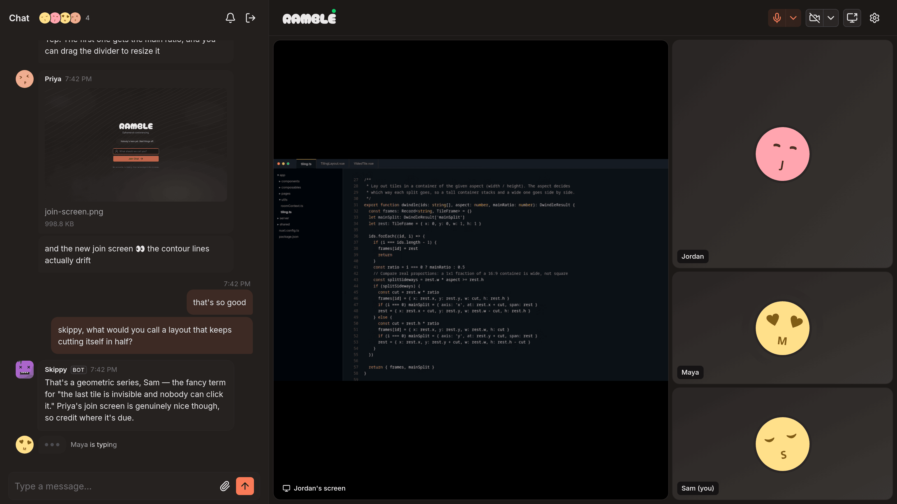
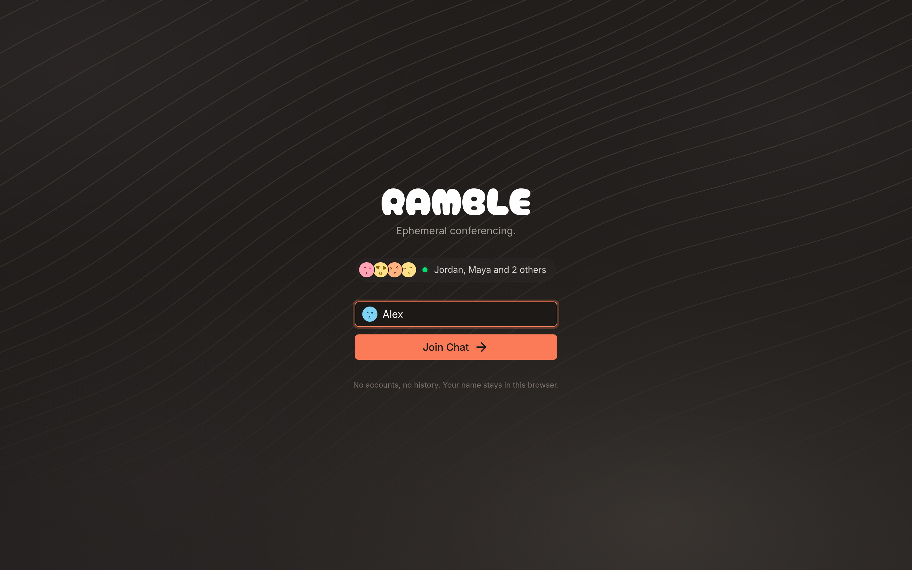
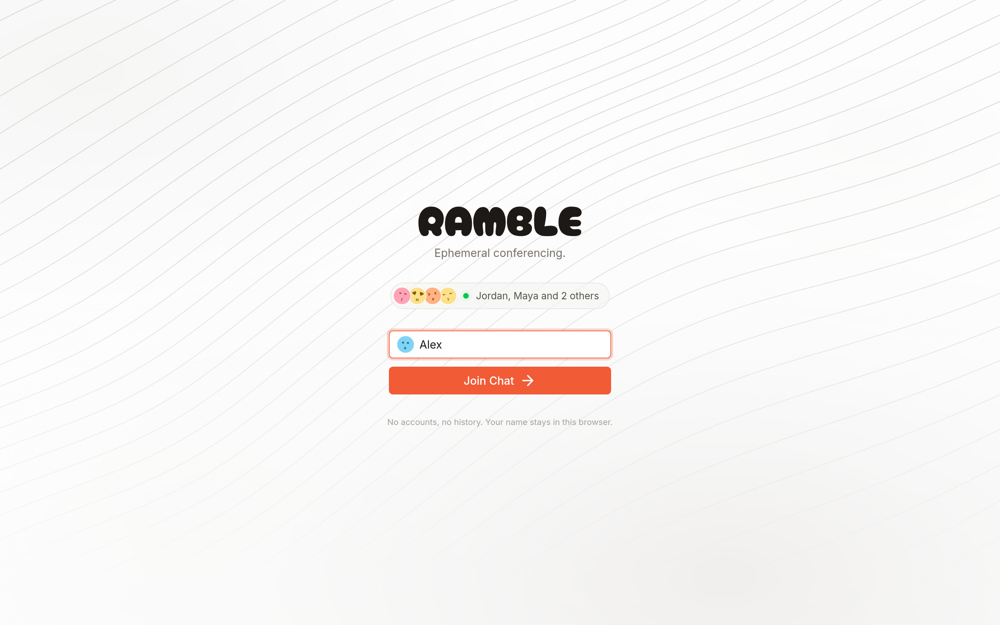
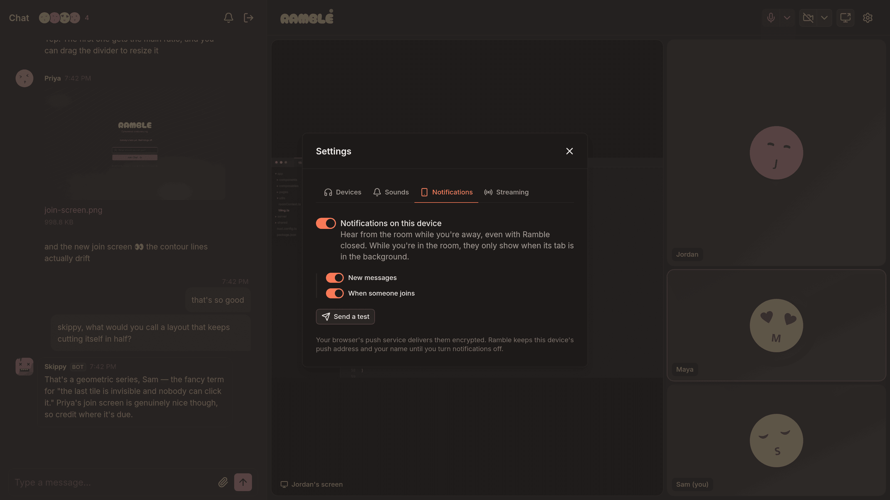
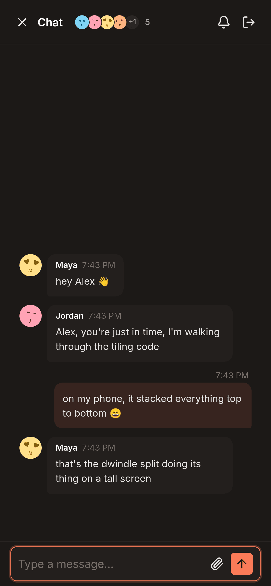
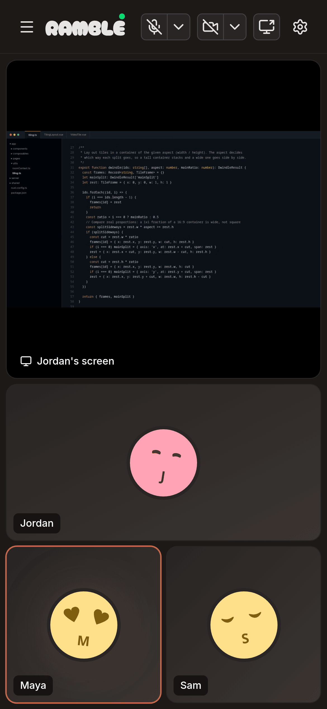

# Ramble

Real-time chat application built with Nuxt 4 and LiveKit, featuring WebRTC-based video, audio, screen sharing, instant messaging, file sharing, and AI bot integration with DiceBear avatars.



<details>
<summary>More screenshots</summary>

<p align="center">
  
  
</p>

<p align="center">
  
</p>

<p align="center">
  
  
</p>

</details>

<sub>Screenshots are staged on a local server with made-up people; the screen share is Ramble's own tiling code.</sub>

## Features

### Core Functionality
- **WebRTC Communication**: Video, audio, and screen sharing via LiveKit SFU
- **Real-time Messaging**: Data channel-based instant messaging with typing indicators
- **File Sharing**: Upload and share images, videos, audio, documents, and archives
- **DiceBear Avatars**: A face with their initial for each person and a robot face for each bot, generated from the name
- **Name-only Entry**: Join conversations without registration or authentication
- **Device Management**: Split mic/camera buttons with device menus right in the toolbar; choices are remembered and applied when you join
- **Keyboard Shortcuts**: <kbd>Ctrl</kbd>/<kbd>⌘</kbd>+<kbd>D</kbd> toggles the microphone, <kbd>Ctrl</kbd>/<kbd>⌘</kbd>+<kbd>E</kbd> the camera (same as Google Meet), even while typing
- **Adaptive Streaming**: Dynamic video quality based on network conditions
- **Click-to-Download**: File attachments with original filename preservation
- **Tiling Video Layout**: Hyprland-style dwindle tiling that always fills the panel. Drag a tile onto another to swap, pin one as main, drag the divider to resize the main split; screen shares take the main slot; your arrangement is remembered per browser
- **WHIP Ingress**: Any member can stream from OBS Studio into the room via WHIP; `/ingress` is a fullscreen, watch-only view of the stream

### AI Integration
- **Multiple AI Bots**: Configurable bots powered by DeepSeek V4.1 Flash via OpenRouter
- **Natural Language Triggers**: Activate bots by name or trigger word; mention several and each replies in turn, seeing the earlier replies
- **Context-Aware Responses**: Bots see recent conversation history, who's in the room, the local time, and which other bots are around
- **Vision**: Bots see images shared in the chat (newest three, up to 5MB each)
- **Typing Indicator**: "Skippy is typing..." while a reply is being generated
- **Bot Management**: Enable/disable bots through UI; choices persist in localStorage

### User Experience
- **Media Controls**: Intuitive controls for camera, microphone, and screen sharing
- **Audio Level Monitoring**: Real-time audio level visualization
- **Sound Notifications**: Customizable sound effects for chat events (messages, joins, leaves, AI responses)
- **Browser Notifications**: Web Push for new messages and joins, per device and opt-in (Settings → Notifications). Arrives with Ramble closed; inside the room, only while its tab is in the background. iPhone/iPad need Ramble added to the Home Screen first
- **Connection Status**: A dot on the logo (hover for details, including desktop-notification status)
- **Who's Here**: Avatar stack in the chat header and an empty-room view that names who's around and offers one-click camera/screen share
- **Responsive Design**: Mobile-friendly interface with Nuxt UI v4 components
- **File Upload Modal**: Drag-and-drop or button-based file selection with progress tracking
- **Rich Media Display**: Inline preview for images, video, and audio files
- **Fullscreen Video**: Immersive fullscreen viewer with overlayed controls for video streams
- **Video Quality Stats**: Real-time statistics overlay showing resolution, framerate, and bitrate
- **Grouped Messages**: Runs from the same sender share one avatar and header (Nuxt UI `UChatMessage`)
- **Jump to Latest**: Reading older messages keeps your place; new ones are counted on a "3 new" button instead of yanking the view
- **Modern Typography**: Inter font family for clean, legible UI text; Geist Mono for code
- **Persistent Identity**: Cookie-based reconnection within 30-second timeout, auto-filled username
- **Device Preferences**: Remember camera, microphone, and speaker selections across sessions
- **Sound Preferences**: Customizable notification sounds with persistent volume and event mapping

## Technology Stack

See `package.json` for exact versions.

- **Framework**: Nuxt 4 + Vue 3 + TypeScript
- **WebRTC**: LiveKit Client + Server SDK (SFU architecture)
- **UI Library**: Nuxt UI v4
- **Typography**: Nuxt Fonts (Google Fonts) — Inter for UI, Geist Mono for code, Cherry Bomb One for branding
- **Avatars**: DiceBear 10 (initial-face for people, bottts-neutral for bots)
- **AI Provider**: OpenRouter — DeepSeek V4.1 Flash by default, any OpenRouter model per bot
- **Real-time**: LiveKit data channels for messaging
- **File Storage**: nuxt-file-storage with date-based directory structure
- **Video Layout**: Own dwindle tiling (`app/utils/tiling.ts` + `TilingLayout.vue`), no layout library
- **Notifications**: Web Push (`web-push`, VAPID, service worker in `public/sw.js`) + optional ramble-daemon (native desktop)
- **Package Manager**: pnpm (pinned via `packageManager`)
- **Hosting**: Coolify (nixpacks); LiveKit runs as a separate Docker Compose stack

## Setup

### Prerequisites
- Node.js 22+
- pnpm
- LiveKit Server (for WebRTC functionality)
- OpenRouter API key (for AI bots) — https://openrouter.ai/keys
- LiveKit Ingress (optional, for OBS streaming via WHIP)

### Installation

1. Install dependencies:
```bash
pnpm install
```

2. Configure environment:
```bash
# .env
OPENROUTER_API_KEY=sk-or-...                                 # OpenRouter API key
OPENROUTER_MODEL=deepseek/deepseek-v4.1-flash-1017          # Default bot model (OpenRouter id)
LIVEKIT_KEY=devkey                       # LiveKit API key (use 'devkey' for dev mode)
LIVEKIT_SECRET=secret                    # LiveKit API secret (use 'secret' for dev mode)
LIVEKIT_URL=ws://localhost:7880          # LiveKit server URL (dev mode)
NUXT_PUBLIC_SITE_URL=https://lastra.us   # Production URL
NUXT_PUBLIC_VAPID_PUBLIC_KEY=...         # Web Push key pair (npx web-push generate-vapid-keys);
VAPID_PRIVATE_KEY=...                    #   notifications are off when unset
VAPID_SUBJECT=https://ramble.lastra.us   # Contact for the push services
DATA_DIR=/app/data                       # Push subscriptions; needs a persistent volume
FILE_STORAGE_MOUNT=./uploads             # File storage directory (optional, defaults to ./uploads)
EVENTS_TOKEN=long-random-string          # ramble-daemon's key to /api/events (stream is off when unset)
NUXT_PUBLIC_DAEMON_URL=http://localhost:9001   # Local ramble-daemon (optional)
NUXT_PUBLIC_DAEMON_ENABLED=true
```

`.env.example` has the full list.

### Development

1. Start LiveKit server (development mode):
```bash
livekit-server --dev
```

2. (Optional) Start LiveKit Ingress for OBS streaming:
```bash
livekit-ingress --config /path/to/ingress.yaml
```

3. Start Nuxt development server:
```bash
pnpm run dev
```

Application available at `http://localhost:3000`

### Production

ramble.lastra.us runs on Coolify, built with nixpacks (`nixpacks.toml` pins Node 22 and pnpm 10). Pushing to `main` deploys. To build and run it locally:
```bash
pnpm run build
node .output/server/index.mjs
```

## LiveKit Configuration

### Development Mode
```bash
livekit-server --dev
# Dashboard: http://localhost:7880
# WebSocket: ws://localhost:7880
```

### Production
Production LiveKit is its own Coolify app, built from the private repo `slastra/livekit`: one `docker-compose.yaml` with livekit-server, the WHIP ingress, and Valkey. It is separate from this app so a Ramble deploy never drops calls in progress.

| Address | Serves |
|---|---|
| `livekit.lastra.us` | signalling and API; `/whip` goes to the ingress |
| `turn.lastra.us:443` | TURN over TLS for clients on restrictive networks (Traefik terminates TLS) |
| 7881/tcp, 50000–60000/udp | WebRTC media |

Ramble's `LIVEKIT_KEY` / `LIVEKIT_SECRET` must match the key pair configured there.

## Bot Configuration

Two bots ship by default in `content/bots/`: **Columbo** (`columbo.yaml`) and **Skippy** (`skippy.yaml`, tuned toward *Expeditionary Force* canon). Add more by creating YAML files:

```yaml
# content/bots/assistant.yaml
name: "Assistant"
role: "Helpful Assistant"
triggers: [assistant, help]
shyness: 0.5            # 0 = always interjects, 1 = never interjects
temperature:            # 0-1 range
  normal: 0.7           # Used when @mentioned or trigger word matches
  interjection: 0.85    # Used for random interjections
personality:
  normal: "You are a helpful assistant..."
  interjection: "..."
# Optional: pin this bot to a specific OpenRouter model id.
# Defaults to OPENROUTER_MODEL env var. Must accept `temperature` and allow
# reasoning to be disabled (e.g. not z-ai/glm-5.3-flash or minimax/minimax-m3.1-flash).
# model: "anthropic/claude-haiku-4.5"
```

## Commands

```bash
pnpm run dev         # Development server
pnpm run build       # Production build
pnpm run preview     # Preview production
pnpm run typecheck   # TypeScript checking
pnpm run lint        # ESLint with auto-fix
```

## API Endpoints

Unless marked *public*, an endpoint needs the caller's LiveKit token as `Authorization: Bearer <token>`. Endpoints that take a room only accept the room the token was issued for.

### LiveKit & Identity
- `POST /api/livekit-token` — *public*. Issues a 10-minute room token. Refuses the reserved identities `obs-stream` and `ai-*`; `Viewer-*` names (the `/ingress` page) get watch-only tokens
- `POST /api/validate-username` — *public*. Checks a name is free (returning users are recognized by clientId) and not one the user list hides
- `GET /api/room-presence` — *public*. Display names of the people in the room, for the join screen
- `POST /api/whip-ingress` — Creates or returns the room's WHIP ingress (URL + stream key) for OBS
- `POST /api/cleanup-room` — Removes participants that have been disconnected longer than `maxIdleMinutes`

### Bots
- `GET /api/bots` — *public*. Bot configurations from `content/bots/*.yaml`
- `POST /api/chat` — Generate bot replies via OpenRouter and post them to the room. Body: `BotChatRequest` in `shared/types/chat.ts` (`{roomName, userName, content, botNames, isInterjection, context, activeBots?, timeZone?}`); `content` may be a JSON attachment envelope (max 8,000 characters). Returns `{success, replies}`. Bot enable/disable is fully client-side (localStorage).

### Files
- `POST /api/upload` — Upload with MIME validation and per-type size limits; bodies over 150MB are refused
- `GET /api/download/[...path]` — *public*. Download with original filename preserved

### Notifications
- `POST /api/push/subscribe` — Turns notifications on for a device (or refreshes it). The owner is the identity in the caller's LiveKit token; at most 200 devices
- `POST /api/push/unsubscribe` — Turns them off; the subscription endpoint is the proof of ownership
- `POST /api/push/test` — Sends that device a sample notification
- `POST /api/push/joined` — Called by a client once it's connected; pushes "<name> joined" to people who are away (once per person per 5 minutes)
- `POST /api/broadcast-message` — Publishes a sent message to the in-memory bus that feeds `/api/events`, and pushes it to subscribers who aren't in the room
- `GET /api/events?username=X` — SSE stream of every room's messages for ramble-daemon. Requires `Authorization: Bearer <EVENTS_TOKEN>` instead of a LiveKit token

### Rate limits
Tokens are free to mint, so `server/utils/guards.ts` applies per-IP limits (in memory, so they reset on restart). Over the limit, requests get `429` with `Retry-After`.

| Endpoint | Limit |
|---|---|
| `/api/livekit-token` | 20 / minute |
| `/api/validate-username` | 30 / minute |
| `/api/room-presence` | 30 / minute |
| `/api/chat` | 20 / minute |
| `/api/push/subscribe`, `/unsubscribe` | 20 / minute |
| `/api/push/joined` | 5 / minute |
| `/api/push/test` | 5 / minute |
| `/api/broadcast-message` | 60 / minute |
| `/api/upload` | 30 / 10 minutes, and 1GB / hour |
| `/api/whip-ingress`, `/api/cleanup-room` | 10 / minute |

## File Upload System

### Supported File Types
- **Images**: JPEG, PNG, GIF, WebP (max 10MB); SVG (max 2MB)
- **Audio**: MP3, WAV, OGG, M4A, WebM (max 25MB)
- **Video**: MP4, WebM, MOV (max 100MB)
- **Documents**: PDF, DOC, DOCX (max 10MB); TXT, MD (max 1MB)
- **Archives**: ZIP, RAR, 7Z, TAR, GZ (max 50MB)

### Storage Structure
Files are organized by upload date using nuxt-file-storage:
```
uploads/
├── 2025/
│   ├── 01/         # January uploads
│   ├── 02/         # February uploads
│   └── ...
└── [year]/[month]/[uuid-timestamp.ext]
```

### File Upload Architecture
- **Module**: nuxt-file-storage for production-ready file handling
- **Upload**: `POST /api/upload` with MIME validation and size limits
- **Download**: `GET /api/download/[...path]` with original filename preservation
- **Security**: Sanitized filenames, validated MIME types, absolute path resolution
- **Environment**: Configurable storage location via `FILE_STORAGE_MOUNT` env variable

## Avatar System

DiceBear 10 generates every avatar in the browser from the lowercased name:
- **People** get an `initial-face` (their initial as the mouth), **bots** a `bottts-neutral` robot face (rounded square rather than a circle)
- **Consistent**: The same name always produces the same avatar; nothing is stored
- **Lightweight**: Inline SVG data URIs, no network requests
- **Implementation**: `useDiceBearAvatar(name, kind)` where `kind` is `'user'` or `'bot'`

## Architecture

### Composables (`app/composables/`)

**LiveKit core:**
- **useLiveKitRoom**: Room connection, media tracks, participant management
- **useLiveKitChat**: Chat messaging via data channels, typing indicators
- **useLiveKitBots**: Bot mention/interjection detection, calls `/api/chat`
- **useAudioLevelMonitoring**: WebAudio analyser + RMS level calculation
- **useDeviceManagement**: Camera/mic/speaker enumeration and `switchActiveDevice` wrapper
- **useParticipantTracking**: Track subscription state and remote participant lifecycle
- **useEventEmitter**: Tiny generic pub-sub used inside the LiveKit composables

**User & UX:**
- **useUser**: Persistent identity (cookie clientId + localStorage username)
- **useBots**: Loads bot configs and runs client-side mention detection
- **useDiceBearAvatar**: Avatar data URI for a person (initial-face) or bot (bottts-neutral)
- **useSoundManager**: Plays notification sounds
- **useSoundSettings**: Sound preference persistence (volume + per-event mapping)
- **useDevicePreferences**: Camera/mic/speaker selection persistence
- **useDaemonSync**: Browser focus/visibility heartbeats to the optional ramble-daemon
- **usePushNotifications**: Web Push subscribe/unsubscribe, per-device event choices, and notifications for a backgrounded tab

### Type Organization
- `/shared/types/` - Types shared between client and server
  - `chat.ts` - Chat message interfaces and conversion utilities
  - `ingress.ts` - WHIP ingress request/response interfaces
  - `index.ts` - Re-exports
- `/shared/utils/` - Helpers used on both sides (`participants.ts` reserved identities, `messageContent.ts` attachment parsing)
- `/server/types/` - Server-only type definitions (`openrouter.ts`, `h3.d.ts` event context)
- `/server/constants/` - Shared constants like file type definitions
- `/server/utils/` - Server utilities: LiveKit client singleton, OpenRouter, bot context, message bus, `guards.ts` (rate limits, room checks)

### Recent Updates

**October 2026 — LiveKit on Coolify, hardening:**
- **LiveKit**: moved from bare systemd services to a Docker Compose stack on Coolify (`slastra/livekit`) and upgraded 1.9.12 → 1.13.10. TURN over TLS on `turn.lastra.us:443` now works; it never had, because Traefik sent 443 to an HTTP route instead of TURN.
- **Events stream**: `/api/events` requires `EVENTS_TOKEN`; it used to stream every room's messages to anyone with the URL. ramble-daemon sends it as `token` in its config.
- **Identities**: nobody can join as `obs-stream` or `ai-*`; `/ingress` viewers get watch-only tokens.
- **Abuse limits**: per-IP rate limits, room-bound requests, capped `/api/chat` input, and a 150MB upload body limit.
- **Dependencies**: DiceBear 10 (every avatar changed once); lockfile fixes for advisories in h3, ws, socket.io-parser, defu, tiptap, tar and others; pnpm 10.34.8.

**October 2026 — OpenRouter:**
- **AI provider**: bots moved from Claude on AWS Bedrock to OpenRouter. Default model is `deepseek/deepseek-v4.1-flash-1017`, picked from a persona bake-off: fastest replies, about 6x cheaper than Haiku 4.5, and it honors per-bot temperature. Set `OPENROUTER_API_KEY`; AWS credentials are no longer used.
- **No SDK**: the server calls OpenRouter's chat completions endpoint with `$fetch`; the `@anthropic-ai/*` packages and the Bedrock IAM script were removed.
- **Chat participants**: the OBS ingress stream and `/ingress` viewers are hidden from the user list and excluded from bot interjection math.
- **Smarter bots**: room awareness (roster, local time, other bots, chat conventions), vision on shared images, a typing indicator, multi-bot mentions answered in sequence, replies trimmed to the last full sentence if they hit the token limit, and per-bot robot avatars.
- **Fixes**: bot on/off toggles now persist across reloads; bot replies now reach the ramble-daemon SSE stream.

**April 2026 — AI provider migration:**
- **Bedrock + Claude**: AI bots now run on Claude Haiku 4.5 via AWS Bedrock (replaces Google Gemini). Credentials via standard AWS chain; no API key in env.
- **Structured chat protocol**: `/api/chat` accepts `{userName, content, botName, isInterjection, context}` instead of a `"Name: content"` string. Removed server-side string parsing.
- **Bot temperature**: now constrained to Anthropic's `0–1` range (was Gemini's `0–2`); schema enforces it.
- **Vestigial fields removed**: `tools` dropped from bot YAML schema; `userCount` and `_isInterjection` removed from `/api/chat`.

**October 2025:**
- **User Preferences**: Cookie-based persistent identity, remembered device selections, sound preferences
- **Reconnection**: Seamless reconnection within 30-second timeout using persistent clientId
- **Enhanced UX**: Auto-filled username with "Welcome back" message, privacy controls
- **WHIP Ingress**: OBS streaming support via WHIP protocol with bypass mode
- **Typography**: Switched to Inter + Geist Mono for modern, clean UI
- **Chat UX**: Scroll-to-bottom button, fixed avatar squishing, improved layout
- **AUR Package**: Published livekit-ingress to Arch User Repository

**September 2025:**
- **Code Reduction**: 755+ lines of dead code removed, 16 files deleted
- **Shared Utilities**: Centralized RoomServiceClient, file type definitions
- **Legacy Removal**: Eliminated bridge layer and defunct slash command system
- **Type Safety**: Shared type definitions replacing redundant conversion layers

## License

MIT
